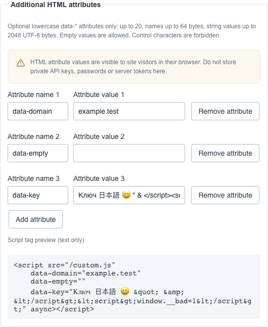

# Custom JS HTML attributes — MODX 3

Реализовано 26 ноября 2026 в `codex/modx3-custom-js-attributes`, база `origin/modx3` (`59f406daf24b1f7c6f62446119a46e97e22b7079`).

Custom JS позволяет передать публичный ключ Ahrefs непосредственно через Manager,
без промежуточного JS-файла. Реальные аналитические аккаунты и Ahrefs в тестах не использовались.
Стабильная версия, registry schema 1, main/modx3 и опубликованные пакеты не изменены.

## Конфигурация

```json
{
  "path": "https://analytics.ahrefs.com/analytics.js",
  "attributes": {
    "data-key": "YOUR_AHREFS_PUBLIC_SITE_KEY",
    "data-domain": "example.com",
    "data-mode": "production"
  }
}
```

В Manager: Custom JS → Analytics, URL выше, строка `data-key` со значением публичного
ключа сайта из настроек Ahrefs. Включить сервис и сохранить. Поле `attributes`
необязательно. Пустой объект удаляется из канонической конфигурации.

Допускается до 20 имён по `^data-[a-z0-9][a-z0-9_-]*$`, до 64 байт на имя и
2048 байт UTF-8 на строковое значение, включая пустую строку. Заглавные буквы
отклоняются во всех трёх слоях. C0/C1 управляющие символы, дубликаты, нестроковые
значения и все атрибуты вне `data-*` запрещены. После JSON-разбора registry
ограничен 32768 байтами; публичная HTML-safe сериализация может быть больше из-за
`\u003c` и аналогичных escape-последовательностей. Её входной envelope ограничен
шестикратным размером, после декодирования действует прежний лимит данных.
PHP сохраняет прежний лимит входного registry JSON.

**Значения видны посетителям в браузере. Здесь нельзя хранить приватные API-ключи,
пароли или серверные токены.** Обработчик ошибок не логирует значения.

## Реализация и согласия

- PHP и общий `custom-js-config.js` проверяют структуру и атрибуты. Повторяющиеся
  JSON-ключи, включая escaped spelling, отклоняются до преобразования в словарь.
  PHP использует линейный scanner, проверенный на длинных строках.
- Processor сохраняет различие JSON-объекта и массива до проверки registry;
  `[]`, `null` и прочие формы `attributes` отклоняются. Пустые legacy config
  продолжают обрабатываться существующим механизмом.
- Непустые атрибуты сортируются и входят в service privacy fingerprint. Для
  отсутствия атрибутов и `{}` fingerprint побайтно совпадает с прежним:
  `[2,"custom_js","analytics","custom",{"path":"/custom.js","purpose":"Site statistics"}]`.
- Существующий `CookieConsentSettings::save` увеличивает version только изменившейся
  категории. `categoryProcessing` сравнивает атрибуты по значению, поэтому
  повторный save и перестановка строк не создают ложный запрос согласия.
- Добавление, изменение и удаление атрибута требуют нового выбора затронутой
  категории. Независимые категории сохраняют разрешение. Последний атрибут
  удаляется обратно к исходной конфигурации, но разрешение ранее изменённой
  категории всё равно проверяется существующей моделью category versions.
- Strict блокирует загрузку до необходимого согласия. Legacy first visit,
  сохранённый отказ и отзыв работают по прежним правилам. Отдельного consent store нет.
- Runtime устанавливает весь набор через `setAttribute` до `appendChild`. Ошибка
  проверки не создаёт элемент. URL кешируется вместе с каноническим набором
  атрибутов: несовпадение явно отклоняется, повторного исполнения нет.
- Запрет повторяющихся Custom JS URL и URL validator сохранены. Dispatcher
  `service-loaders.js` проверен; изменения не требуются. Остальные адаптеры
  используют прежние вызовы runtime без атрибутов.
- Manager использует существующие `field`, `el`, `note`, vanilla JS, подписанные
  поля, клавиатурную навигацию и сохранение ошибочных строк для исправления.
  Предпросмотр создаётся исключительно через `textContent`; script не создаётся.
  Переводы добавлены во все поставляемые manager locales: RU/EN.
- Новый shared module включён в frontend manifest, оба transport delivery пути
  и Manager controller. Production JS по-прежнему строится установленным MODX;
  предсобранный production bundle не входит в transport.

## Проверки

| Проверка | Результат |
| --- | --- |
| Custom PHP / processor | PASS: 79 assertions на PHP 8.1.34, 8.2.34, 8.5.10 |
| Новые isolated Chromium tests | PASS: 10 сценариев / 85 assertions |
| Существующие `tests/modstore/local.mjs` | PASS: 22 suites (PHP, Manager/i18n, consent, adapter sync/cache, guide/version, video) |
| Полная `tests/video-embeds/differential.mjs` | PASS: 49 сценариев / 253 assertions, финальный bundle |
| Native MODX 3.2.4-pl / PHP 8.2.34 | PASS: 121 assertions, реальные Manager/API/consent |
| Native previous → candidate upgrade | PASS: settings bytes, raw consent, fingerprints и загрузка сохранены |
| Transport normalize / verify | PASS: 233 runtime files, 250 native vehicles, 727 ZIP entries |
| Native rebuild / cache / failure fallback / uninstall | PASS, пользовательские файлы и журнал сохранены |

Сценарии задания 1–11 покрыты PHP/processor и browser validation; 12–14 —
нативным Manager (создание, изменение, удаление, reload и инертный preview);
15–17 — browser и native consent/dedup; 18–21 — fingerprint, categoryProcessing,
настоящий save API и upgrade; 22 — полным differential и существующими PHP suites.
Загрузочный fixture читает `document.currentScript` в момент исполнения.
Отдельно проверены пределы байтов, Unicode/кавычки/HTML, пустая строка,
HTML-safe JSON больше 32 КБ при допустимом размере данных, ошибочные raw JSON
и API-запросы без частичного сохранения/загрузки.

Исходные результаты: [PHP](custom-js-attributes/php.json),
[browser](custom-js-attributes/browser.json),
[existing suites](custom-js-attributes/existing-local-suites.json),
[differential](custom-js-attributes/differential.json),
[native](custom-js-attributes/native.json),
[upgrade](custom-js-attributes/upgrade.json),
[lifecycle](custom-js-attributes/lifecycle.json).
MODX core requests к Gravatar/misc.modx.com перехвачены и заблокированы;
компонент не обращался к внешним сервисам в тестах.

## Manager UI

Скриншоты реального Manager с локальным тестовым JS и публичными тестовыми значениями:



[Весь экран Services](custom-js-attributes/manager-services.png).

## Сборка и ограничения

Тестовый transport создан в отдельном `.local/custom-js-attributes-verified-tests/`
под прежней подписью `cookieconsentmanager3-1.0.8-pl9`; это внутренний acceptance artifact,
не новый релиз. SHA-256: `8d02b1bb3d753f1cbf148cad1d10d3157b69d8e2dfc67cbfa96a388ba5aa4ee0`.
Восемь существующих ZIP в `dist/`, включая оба Windows beta126 и pl8/pl10,
сохранили ранее зафиксированные SHA-256. Существующие worktree и корневой WIP сохранены.
Changelog содержит пять последних записей, включая Unreleased; стабильная версия не поднята.

Прямое пересечение с [Windows hotfix PR #21](https://github.com/web86/cookie-consent-manager/pull/21) —
только `_build/transport-files.json`. При объединении сохранить новые mappings
`custom-js-config.js` и записи Windows filesystem helper. Косвенное пересечение —
валидация путей и синхронизация/сборка новых runtime-файлов в установщике.
После слияния обеих функций требуется совместный прогон registry/Manager/consent,
adapter sync/cache, relocated paths, transport install/upgrade/uninstall на Windows.
Ни hotfix-ветка, ни её PR в этой задаче не менялись. Текущие ограничения Windows/JIT
из hotfix PR этим изменением не исследовались и не устраняются.

Проверены Chromium и Linux MODX 2.8.8/3.2.4 на PHP 8.2; PHP validation дополнительно
на 8.1 и 8.5. Другие браузерные движки, production deployment и реальная доставка
в Ahrefs вне этого прогона. Merge, GitHub Release и публикация в Modstore не выполнялись.

## Изменённые файлы

- `README.md`
- `_build/changelog.md`
- `_build/frontend-manifest.json`
- `_build/package-readme.md`
- `_build/transport-files.json`
- `_build/user-guide-manifest.json`
- `_build/user-guide.json`
- `assets/components/cookieconsentmanager3/js/cookie-consent/cookie-consent.min.js`
- `assets/components/cookieconsentmanager3/js/cookie-consent/custom-js-config.js`
- `assets/components/cookieconsentmanager3/js/cookie-consent/provider-registry.js`
- `assets/components/cookieconsentmanager3/js/cookie-consent/service-runtime.js`
- `assets/components/cookieconsentmanager3/js/cookie-consent/services/custom-js.js`
- `assets/components/cookieconsentmanager3/manager.css`
- `assets/components/cookieconsentmanager3/manager.js`
- `docs/custom-js-attributes.md`
- `docs/custom-js-attributes/browser.json`
- `docs/custom-js-attributes/differential.json`
- `docs/custom-js-attributes/existing-local-suites.json`
- `docs/custom-js-attributes/lifecycle.json`
- `docs/custom-js-attributes/manager-attributes.png`
- `docs/custom-js-attributes/manager-services.png`
- `docs/custom-js-attributes/native.json`
- `docs/custom-js-attributes/php.json`
- `docs/custom-js-attributes/upgrade.json`
- `server/controllers/index.class.php`
- `server/lexicon/en/default.inc.php`
- `server/lexicon/ru/default.inc.php`
- `server/processors/base.php`
- `server/src/CookieConsentGuide.php`
- `server/src/CookieConsentServiceRegistry.php`
- `server/src/CookieConsentSettings.php`
- `tests/custom-js-attributes/README.md`
- `tests/custom-js-attributes/browser.mjs`
- `tests/custom-js-attributes/fixture.php`
- `tests/custom-js-attributes/native.mjs`
- `tests/custom-js-attributes/php.php`
- `tests/custom-js-attributes/upgrade.mjs`
- `tests/fixtures/custom-js-attributes.js`
- `tests/modstore/static.py`
