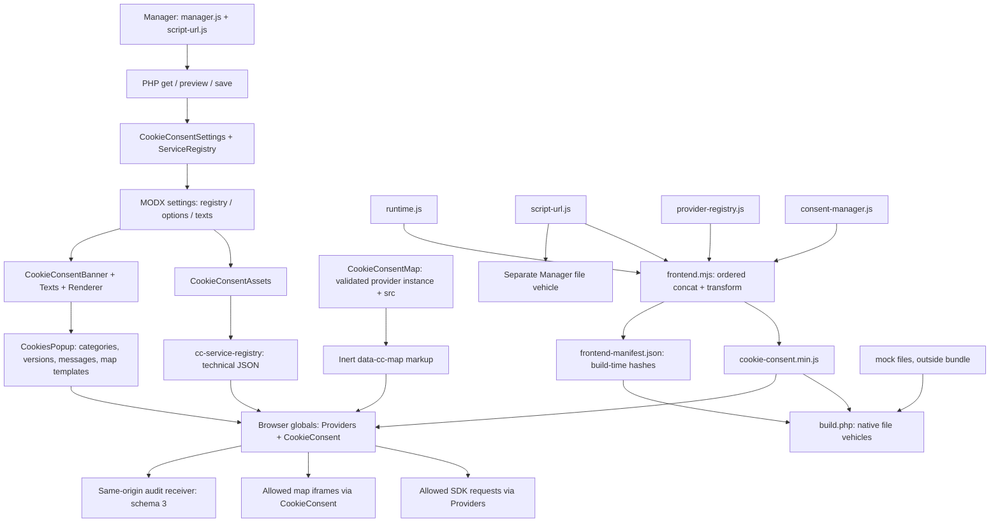
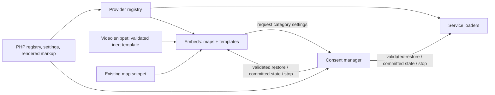

# Инвентаризация frontend JavaScript MODX 2 перед видеосервисами

Дата: 15 октября 2026 года. Область: `web86/cookie-consent-manager`, только MODX 2. Это аудит исходников и план последующих изменений; удаления, рефакторинга, изменения сборки и transport в рамках аудита нет.

## 1. Проверенная версия и границы выводов

Основной объект аудита — локальная ветка `codex/modx2-universal-services`, commit `7cad272e57ff6f4f695b2af1e20e919e15bad5b5`. В [_build/package.json](../_build/package.json) и [CookieConsentVersion.php](../server/src/CookieConsentVersion.php) указана **1.0.4-beta2**. Рабочее дерево перед аудитом чистое.

Удалённый `HEAD`/`main` проверен через `git ls-remote`: `0c5e2fe8a0d9cac67fb7a3e83bd3976fc6b87fd6`. Локальная ветка содержит десять последующих коммитов MODX 2, включая категорийную модель, custom JS, карты и исправления beta2. Удалённой ветки с этим локальным именем и тегов `v1.0.4*` при проверке нет; GitHub connector возвращает ветки `main` и `modx3`. Поэтому аудит выполнен по более новой локальной beta2, а не по более старому remote main. Более поздняя реализация MODX 2 в проверенных refs не обнаружена. Ветка MODX 3 не читалась и не изменялась.

[Issue #12](https://github.com/web86/cookie-consent-manager/issues/12) прочитан непосредственно через GitHub connector (open; `updated_at=2026-10-15T10:38:00Z`). Его положения о grants/fingerprints и прямом разрешении отдельных сервисов предшествуют текущему `categories_v2`; ниже дана их адаптация. Старые acceptance-документы не использовались вместо проверки текущего кода.

«Production» в таблицах означает стандартный путь поставки и выполнения компонента в режиме `live`, а не подтверждение установки на конкретном сайте. Клиентские шаблоны, CDN, Safari и реальная доставка данных поставщикам в этом аудите не проверялись. Наличие файла на тестовом сервере само по себе не доказывает включение в пакет: [tests/local/sync.php](../tests/local/sync.php) копирует всё дерево `assets`, тогда как native builder использует явный список.

## 2. Полная инвентаризация `assets/js/cookie-consent/`

Найдено **19 файлов**: 4 ACTIVE, 4 LEGACY, 10 TEST-ONLY и 1 GENERATED. UNKNOWN нет. Статус отражает основную роль файла: TEST-ONLY у mock означает тестовые/демонстрационные данные, **которые сейчас действительно поставляются transport-пакетом**.

Обозначения: «через bundle» — код исполняется в production, но отдельный исходник не устанавливается; «syntax» — общий синтаксический проход [tests/release/syntax.py](../tests/release/syntax.py), а не функциональное использование.

| Файл относительно `assets/js/cookie-consent/` | Класс | Назначение | Production `live` / transport | В frontend bundle | Использование тестами | Дублирование, устаревание и решение |
| --- | --- | --- | --- | --- | --- | --- |
| [runtime.js](../assets/js/cookie-consent/runtime.js) | ACTIVE | `web86Runtime.message()`: чтение PHP-rendered сообщений из DOM и подстановка `{name}` | Да, через bundle; отдельно не поставляется | Да, первый | SSR, локализация, ошибки ACK, public registry; syntax | Не полноценный bootstrap и не старый i18n. Сохранить |
| [script-url.js](../assets/js/cookie-consent/script-url.js) | ACTIVE | Общие JS `valid()`/`identity()` для root-relative и HTTPS `.js`, без загрузки при проверке | Да, через bundle; **также отдельной копией** `assets/components/cookieconsent/script-url.js` для Manager | Да, второй | beta1042 URL parity, custom JS, Manager; syntax | Дополняет PHP-валидацию. Это намеренное повторное использование одного исходника; сохранить оба канала поставки |
| [provider-registry.js](../assets/js/cookie-consent/provider-registry.js) | ACTIVE | Каталог, проверка публичного реестра, legacy fingerprint, category gate, SDK adapters/queues, dedup, revoke и URL карт | Да, через bundle; отдельно не поставляется | Да, третий | browser, universal matrix, live-guard, parameters, pixels, callbacks, public registry; syntax | Содержит несколько ответственностей; сохранить, выделить SDK и map URL по плану |
| [consent-manager.js](../assets/js/cookie-consent/consent-manager.js) | ACTIVE | Storage/migration/TTL/versions, категории, UI, audit, callbacks, reload; дополнительно lifecycle iframe-карт | Да, через bundle; отдельно не поставляется | Да, четвёртый | Текущие browser/HTTP/SSR/universal/map/callback/native upgrade suites; syntax | Не устарел. Сохранить consent/UI/audit, вынести специфичный для embeds DOM |
| [cookie-consent.min.js](../assets/js/cookie-consent/cookie-consent.min.js) | GENERATED | Единственный стандартный публичный JS, четыре источника в защитной IIFE | Да; отдельный runtime file vehicle по тому же пути | Это результат сборки | Тесты работают с реальным bundle; beta1042 проверяет deployed SHA; syntax | Не второй поддерживаемый исходник. Хранить/генерировать, вручную не редактировать |
| [analytics.js](../assets/js/cookie-consent/analytics.js) | LEGACY | Старый `web86Analytics.start()`, hardcoded IDs Яндекс/Top.Mail.Ru, собственный script helper и mock-путь | Нет стандартного подключения; не в текущем transport | Нет | Только syntax; функциональных вызовов `web86Analytics` в репозитории не найдено | Дублирует часть `provider-registry.start()`. Кандидат на удаление из текущих sources после проверки ручных интеграций; архив возможен |
| [marketing.js](../assets/js/cookie-consent/marketing.js) | LEGACY | Старый `web86Marketing.start()`: в live ничего не запускает, в mock добавляет локальный marketing script | Нет стандартного подключения; не в текущем transport | Нет | Только syntax; функциональных вызовов `web86Marketing` не найдено | Устаревший TODO об отсутствии пикселей расходится с действующими VK/Meta/Google adapters. Кандидат на удаление/архив |
| [i18n.js](../assets/js/cookie-consent/i18n.js) | LEGACY | Автономный `web86I18n.ready/t/config/locale`, старый `cc-public-config` или fetch словаря | Нет стандартного подключения; не в текущем transport | Нет | **Прямое чтение и исполнение** в `tests/locale-guide/examples.mjs:49–59`; syntax | Исторический standalone compatibility helper. Архивировать только вместе со словарём, тестом и документацией; простое удаление сломает тест |
| [lexicons.json](../assets/js/cookie-consent/lexicons.json) | LEGACY | RU/EN словарь для старого standalone i18n | Нет; не в текущем transport | Нет | Прямо подставляется route в том же standalone-тесте | Частично дублирует PHP lexicons, содержит старые формулировки индивидуальных разрешений. Не источник текущих строк MODX; сохранять парой с i18n до отдельного решения |
| [mock/google_ads.js](../assets/js/cookie-consent/mock/google_ads.js) | TEST-ONLY | Локальное событие `web86:mock-script-loaded`, Google Ads | В live нет; **в transport есть**, mock mode | Нет; отдельный HTTP-запрос | browser category matrix, universal matrix | Активная fixture. Сохранить |
| [mock/google_ga4.js](../assets/js/cookie-consent/mock/google_ga4.js) | TEST-ONLY | То же для GA4 | В live нет; в transport есть | Нет | browser, universal matrix | Сохранить |
| [mock/google_gtm.js](../assets/js/cookie-consent/mock/google_gtm.js) | TEST-ONLY | То же для GTM | В live нет; в transport есть | Нет | browser, universal matrix | Сохранить; проверять текущие category rules, а не старую зависимость GTM от всех grants |
| [mock/google_maps.html](../assets/js/cookie-consent/mock/google_maps.html) | TEST-ONLY | First-party iframe-документ Google Maps без внешних ресурсов | В live нет; в transport есть | Нет | browser, universal matrix, stand/demo | Не JS-loader: загружается как iframe через текущий map lifecycle. Сохранить |
| [mock/mailru.js](../assets/js/cookie-consent/mock/mailru.js) | TEST-ONLY | Локальная `_tmr`-запись, лог и mock event | В live нет; в transport есть | Нет | browser, universal matrix | Сохранить; исторический ID внутри fixture не является production config |
| [mock/marketing.js](../assets/js/cookie-consent/mock/marketing.js) | TEST-ONLY | Локальный marketing event для loader `mock_marketing` | В live нет; в transport есть | Нет | `tests/local/provision.php`, browser и callbacks | **Не путать с корневым `marketing.js`**: используется текущим registry, удалять нельзя |
| [mock/meta_pixel.js](../assets/js/cookie-consent/mock/meta_pixel.js) | TEST-ONLY | `__serviceLoads` и `web86:service-loaded` для Meta | В live нет; в transport есть | Нет | universal matrix, mock integration | Активная fixture; иной формат события не делает её legacy. Сохранить |
| [mock/vk_ads.js](../assets/js/cookie-consent/mock/vk_ads.js) | TEST-ONLY | То же для VK Ads | В live нет; в transport есть | Нет | universal matrix, mock integration | Сохранить; VK Ads и будущий VK Видео — разные loaders |
| [mock/yandex.js](../assets/js/cookie-consent/mock/yandex.js) | TEST-ONLY | Локальный `ym`, callback `getClientID`, mock event | В live нет; в transport есть | Нет | browser, universal matrix, управляемые ClientID-сценарии | Сохранить; не заменяет проверки live SDK queues |
| [mock/yandex_maps.html](../assets/js/cookie-consent/mock/yandex_maps.html) | TEST-ONLY | First-party iframe-документ Яндекс.Карт | В live нет; в transport есть | Нет | browser, universal matrix, stand/demo | Сохранить |

Все восемь `.js` в `mock/` также попадают в общий syntax scan. Все десять файлов просмотрены: сами fixtures не содержат внешних загрузок. Но **режим mock не является sandbox для `custom_js`**: ветка custom path исполняется до проверки `mode === 'mock'`, а beta2 допускает HTTPS paths. Соответствующие тесты перехватывают запросы; произвольный настроенный custom JS может обратиться наружу и в mock-странице. Источник: [provider-registry.js:122–134](../assets/js/cookie-consent/provider-registry.js#L122-L134).

### Основания классификации

- [_build/frontend.mjs:6–17](../_build/frontend.mjs#L6-L17) явно перечисляет четыре JS-входа. Это конкатенация IIFE и `esbuild.transform`, **не** ESM dependency traversal и не `esbuild.build({bundle:true})`. Ни `import`, ни require между публичными исходниками нет; связь идёт через `window`.
- [_build/build.php:35–51](../_build/build.php#L35-L51) проверяет frontend manifest и поставляет bundle, все файлы `mock/`, CSS и отдельный Manager script-url. Остальные публичные исходники в текущий transport не копируются.
- [CookieConsentAssets](../server/modx2-assets-snippet.php) выдаёт CSS + единственный deferred bundle; [demo.html](../demo.html) также подключает bundle, а не legacy adapters. Совпадения названия `marketing.js` в тестах относятся к `/mock/marketing.js`.
- Поиск имён `web86Analytics`/`web86Marketing` не обнаружил потребителей, кроме определений. Для `web86I18n` найден самостоятельный compatibility-тест. Это проверка использования в репозитории, а не доказательство отсутствия ручных подключений на сторонних установках.
- [Исторический standalone i18n документирован](modx2-locale-guide.md#compatibility). Старые инструкции в [modx2-transport-package.md](modx2-transport-package.md), предлагающие `i18n.js` и отдельные scripts, не соответствуют актуальному builder. Их следует явно пометить историческими при следующей документационной правке.

## 3. Фактические зависимости, сборка и transport



### Build path

`npm run build:frontend` → `_build/frontend.mjs` → `runtime.js; script-url.js; provider-registry.js; consent-manager.js` внутри общей защитной IIFE → minified JS; отдельно minified CSS. Версия esbuild закреплена **0.28.2**, target `es2020`. В manifest хешируются четыре JS, CSS, `package-lock.json`, сам builder и оба результата. Порядок — часть контракта: `provider-registry` немедленно читает `web86ScriptUrl.valid` и JSON; `consent-manager` захватывает `web86Providers`.

`window.web86CookieConsentFrontendInitialized` защищает весь bundle от повторного выполнения. `provider-registry` вычисляет относительную базу mock scripts из `document.currentScript.src`; новые модули не должны менять это на иной путь случайно. Общая IIFE не устраняет код неиспользуемых адаптеров или live/mock branches. Источник: [frontend.mjs](../_build/frontend.mjs).

`_build/transport.mjs` последовательно запускает version generator, guide generator, frontend builder, затем native PHP builder в disposable MODX. Сам `build.php` **не собирает JS**, а отклоняет устаревшие inputs/outputs по SHA. MODX runtime вообще не выполняет minification. Проверенный transport содержит 57 runtime files, включая 11 публичных файлов из исследованного каталога: bundle + 10 mock. `script-url.js` дополнительно поставляется по Manager-пути. Frontend manifest — build-time проверка, а `source-inventory.json`/`.inventory.json` transport — инвентарь реально устанавливаемых путей; это разные документы.

Каждому runtime-файлу соответствует native `xPDOFileVehicle` с `INSTALL_FILES`/`UNINSTALL_FILES`, GUID от конечного пути; рекурсивной установки всего JS-каталога нет. PHP classes/lexicons/processors/controllers/templates копируются из соответствующих `server/*`. Четыре canonical snippets и `CookiesPopup` устанавливаются как MODX objects, их исходники обновляются при upgrade; ID/метаданные и настройки сохраняются по native policy. Источник: [build.php:60–101](../_build/build.php#L60-L101).

### Runtime path

1. Manager получает полный registry, каталог, bool defaults и строки из PHP. Save валидирует данные и пересчитывает `category_versions` под транзакцией; JS не определяет серверную версию обработки.
2. `CookieConsentAssets` читает settings, делает `publicRegistry()` и регистрирует JSON через `regClientStartupHTMLBlock`. Возвращает CSS и deferred bundle с content-hash query. JSON регистрируется после resource parsing, чтобы структурные скобки не исполнялись Fenom. Это существенное требование совместимости.
3. `CookieConsentBanner` разрешает язык по context `cultureKey`, применяет PHP fallback/overrides и renderer. Баннер несёт visibility, category versions, policy version, TTL, audit URL, готовые тексты/ARIA и **инертные шаблоны заглушек карт**. Это ещё не универсальные шаблоны внешнего embed content из Issue #12.
4. `provider-registry` проверяет schema 1 JSON, закрытый каталог loaders/config, keys, paths и конфликты. `services` содержит только enabled entries. При ошибке весь реестр становится пустым, произвольный loader не исполняется. Публичная проекция не содержит обычные `name`/`purpose`; исключение — `custom_js.purpose`, нужный для legacy identity. Старый полный JSON принимается для cached HTML.
5. `consent-manager` читает только свой validated committed state; проверяет policy/TTL/category versions, мигрирует legacy grants и применяет разрешённые категории. `provider-registry.apply()` запускает SDK, а `consent-manager.applyConsent()` создаёт iframe карт. Draft checkbox и audit DOM event сами по себе ничего не разрешают.
6. `CookieConsentMap` принимает **instance key** в `provider` и `src`, валидирует host/path/params и выдаёт `data-cc-map-*` без iframe. В браузере URL проверяется повторно, а enabled service и PHP placeholder template нужны для mount. Map button открывает настройки категории; commit разрешает все enabled services этой категории.
7. При отзыве `registry.revoke()` останавливает управляемые запуски/очереди, map frames удаляются; reload ждёт audit delivery либо 900 ms. Новые grants уже действуют до ACK — audit failure не является откатом согласия. Это существующий контракт, его не следует незаметно менять при выделении модулей.

Основные источники: [ServiceRegistry](../server/src/CookieConsentServiceRegistry.php), [Settings:118–150](../server/src/CookieConsentSettings.php#L118-L150), [Renderer](../server/src/CookieConsentBannerRenderer.php), [consent-manager:123–204](../assets/js/cookie-consent/consent-manager.js#L123-L204), [commit:230–251](../assets/js/cookie-consent/consent-manager.js#L230-L251).

`CookieConsent` остаётся поддерживаемым legacy **способом подключения** Assets/Banner, а не старым JS-движком. Его нельзя смешивать со split-вызовами. `CookieConsentRegistry` — отдельный compatibility snippet, **не вызываемый** текущими Assets/Banner и не включённый в canonical objects builder; старый установленный MODX element сохраняется. Это не основание удалять его из БД при JS-очистке. См. [legacy snippet](../server/modx2-consent-snippet.php), [compatibility snippet](../server/modx2-registry-snippet.php), [native tests](../tests/beta33/native.mjs).

## 4. Ответственности и проблемные границы

| Узел | Фактическая ответственность | Оценка |
| --- | --- | --- |
| `runtime.js`, 11 строк | Только динамические сообщения PHP → JS | Граница узкая и корректная; не переносить сюда интеграции лишь из-за названия runtime |
| `consent-manager.js`, 382 строки | Consent state, migration, storage, UI, audit, callback API, reload **и** карты/iframe/modal details | Есть смешение consent orchestration и embed DOM. SDK самостоятельно не загружает |
| `provider-registry.js`, 192 строки | Validation/catalog/identity **и** SDK loading/queues/revoke/Google Consent Mode **и** map URL policies | Главный второй узел смешения. Название registry скрывает интеграционный движок |
| PHP Service Registry/Settings | Trusted schema/catalog/config и persistence/versioning; public projection | Правильная серверная роль. Не переносить server trust в frontend и не раздавать полный Manager registry публично |
| MODX snippets/Renderer | HTML, локализация, безопасные URL generated iframe, интеграция в MODX parsing | Правильная роль; при видео потребуется общий контракт inert markup, а не перенос HTML construction в consent core |
| Manager | Редактирование данных, предварительная JS-проверка и изолированный preview | Не запускает публичный bundle/SDK. Preview повторяет внешний вид, не является вторым consent engine |
| Frontend/native builders | Явный порядок sources, deterministic transform/hash, package files/objects | Не runtime discovery. Любое выделение JS требует обновления списка входов и manifest |

Конкретные участки `consent-manager.js`, которые следует вынести:

- `maps`, `pendingMapDialog` и map-specific данные, строки 26, 36.
- Map loop внутри `applyConsent()`, строки 193–203; frame attributes, insert/remove и placeholder visibility.
- Map frame cleanup при revoke, строка 242; возврат modal после commit, строки 248–251.
- `setupMaps()`, строки 254–281: поиск wrappers/templates, URL selection, клонирование placeholder, обработчик кнопки, modal/focus integration.

Storage/TTL/migration, категории/versions, `commit`, `emitAudit`/queue/ACK, `getConsent`, `onAllowed`/unsubscribe/`stillAllowed`, обычные banner controls и общий focus возврат относятся к consent manager. Выносить каждый из них в отдельный файл перед видео не требуется. «Только категории, состояние и события» здесь означает отсутствие vendor/embed implementation; необходимый consent UI и audit lifecycle остаются одной связной ответственностью.

### Ограничения текущего lifecycle

`setupMaps()` запускается один раз из `initialize()`, ищет wrappers во всём document и вызывает `replaceChildren()`. Это **не idempotent mount API**: повторный вызов уничтожил бы содержимое и добавил повторные entries; late AJAX maps автоматически не монтируются. Публичный API сейчас содержит `getConsent`, `openSettings`, `onAllowed` и mock-only reset, **не `mountEmbeds`**. Без banner root core возвращается до инициализации. Новая система должна учитывать этот startup contract. Источник: [consent-manager:254–281,329–382](../assets/js/cookie-consent/consent-manager.js#L254-L382).

SDK dedup сейчас имеет два уровня: script URL → Promise и service token (`key` для custom JS, `loader:id` для готового SDK); gtag library дополнительно общая. `started` отмечается до завершения загрузки; rejected script Promise сохраняется, автоматического retry нет. Это не недостижимый код: поведение нужно сохранить при механическом переносе, а retry менять отдельно. Отзыв включает остановку pending VK/Meta queues, Google Consent Mode и guard после async Meta load; простой перенос `switch` без этих состояний повредит существующим интеграциям. См. [provider-registry:72–166](../assets/js/cookie-consent/provider-registry.js#L72-L166).

## 5. Дублирующийся, устаревший и неиспользуемый код

### Подтверждённые кандидаты на очистку

1. **`analytics.js`** повторяет script insertion, Яндекс/Top.Mail.Ru init и mock loading из действующего registry, но берёт IDs из констант. Текущий consent manager не вызывает `web86Analytics`. Сохранение этого файла рядом с текущими источниками повышает риск ошибочного ручного подключения и двойного tracking.
2. **Корневой `marketing.js`** повторяет mock script insertion; его live no-op/TODO устарел. `web86Marketing` не имеет текущих потребителей.
3. **`i18n.js` + `lexicons.json`** — второй, исторический канал текстов. Текущий PHP renderer/lexicons/overrides заменили его в MODX integration. Это не полностью неиспользуемая пара: standalone-тест и compatibility-документация намеренно её поддерживают. Удалять без переноса/пересмотра этого контракта нельзя.
4. Исторические комментарии в `provider-registry.js:1` («local custom script paths») не отражают поддержку HTTPS в beta2. Старые provider-grant формулировки словаря и standalone demo нельзя принимать за описание текущей категорийной модели. Сам [demo.html](../demo.html) использует текущий bundle, но его map copy ещё говорит об отдельном сервисе; исправление текста — отдельная работа.

### Повторение правил, которое не является мёртвым кодом

- PHP и JS повторяют каталог loaders, bool defaults, ID patterns, schema/config restrictions, path validation. Manager берёт каталог/defaults из PHP, но имеет свои предварительные ID/duplicate checks. Это разные trust boundaries, а не повод удалить серверную или браузерную проверку. Особенно важны beta2 [URL parity vectors](../tests/beta1042/urls.php) и [проверка в браузере](../tests/beta1042/accept.mjs).
- PHP map snippet и `provider-registry.mapUrl()` повторяют map host/path/parameter allowlists. Сохранить обе проверки и сопоставимые test vectors; frontend policy можно переместить в embeds, PHP policy останется на сервере. Generic trusted template не должен случайно попасть под эти allowlists.
- Visibility читают и registry, и consent manager; maps дополнительно проверяют категории напрямую. При реорганизации нужен единый внутренний путь проверки committed permission, чтобы новые embeds не расходились с SDK. Пока повторение работает с одним PHP contract.
- PHP Renderer и `manager.js` повторяют построение banner/map preview. Preview использует sandbox iframe и CSP `default-src 'none'`; production scripts в него не подключаются. В следующих изменениях следует синхронизировать данные/вид, сохранив изоляцию, а не исполнять настоящий embed ради preview.
- Форматирование `{name}` есть в standalone i18n и `runtime.message()`, но runtime не загружает словарь и не ждёт Promise. Объединение активировало бы лишний legacy pipeline.

### Что выглядит старым, но необходимо

- `fingerprint` v2 в registry, чтение legacy `providers`, `web86_cookie_consent_legacy_v2` и удаление старых provider-controls — compatibility/migration, а не текущие service grants. Нельзя удалять вместе с неиспользуемыми adapters.
- [readConsent:123–149](../assets/js/cookie-consent/consent-manager.js#L123-L149) сохраняет оригинальный legacy JSON отдельно, разрешает миграцию целой категории только при полном совпадении enabled members, учитывает category versions. Новая запись `categories_v2` не содержит `providers`.
- [EventValidator](../server/src/CookieConsentEventValidator.php) поддерживает исторические schema 1/2 и `map_allow/map_deny` для них, но **schema 3 отклоняет map/provider events и лишние provider fields**. Наличие этих имён в PHP не означает, что новый frontend их генерирует.
- `mock_marketing`, десять fixtures и mock branches активно нужны текущим категориям/сетевым тестам. Формат событий между старшими и более новыми fixtures различается, но это не доказательство неиспользования.
- Экспортируемые `hosts` и `categories` в `web86Providers` — метаданные; в текущем production flow `hosts` не служит сетевым фильтром. Отсутствие внутреннего потребителя отдельного export не доказывает безопасность его удаления для внешнего site code. Инвентарь публичного API надо сохранять при рефакторинге.

## 6. Рекомендуемая структура без избыточного дробления

Предлагается **два новых JS-модуля**, с сохранением существующих имён и публичных API. Отдельные `map-embeds.js`, `video-embeds.js`, `template-embeds.js` сейчас дали бы три очень похожих lifecycle и больше связей, чем пользы.

```text
assets/js/cookie-consent/
  runtime.js             # PHP-rendered dynamic messages
  script-url.js          # shared Manager/frontend JS URL contract
  provider-registry.js   # registry validation, instances, legacy identity, policy facade
  service-loaders.js     # SDK adapters, script dedup, queues, Consent Mode, revoke
  embeds.js              # shared inert mount lifecycle; legacy maps + trusted templates
  consent-manager.js     # category state, persistence, UI, audit, callbacks, orchestration
  cookie-consent.min.js  # generated public bundle
  mock/                  # existing fixtures retained initially

server/
  modx2-map-snippet.php   # existing generated map contract, later extra options
  modx2-video-snippet.php # future: validated video URL/options -> inert template markup
  src/                   # shared PHP embed/URL helpers only where real duplication appears
```

Это **предложение**, перечисленных новых файлов в проверенной реализации нет. IIFE/global style и текущий deterministic builder можно сохранить: переход на ESM, dynamic chunks или новый bundler для этого выделения не нужен.

| Модуль | Что перенести/оставить | Граница взаимодействия |
| --- | --- | --- |
| `provider-registry.js` | Оставить schema/catalog/config validation, normalized enabled instances, legacy identity; сохранить `web86Providers` facade | Сам не конструирует SDK scripts или iframe. Старые `apply/revoke/safeMapUrl/allowed` можно оставить делегирующими методами для совместимости |
| `service-loaders.js` | Перенести `script`, `start`, started/scripts/queue state, Google/Meta/VK processing/revoke | Получает validated instances, актуальный committed snapshot и permission guard. Не читает localStorage, не сохраняет consent, не занимается placeholder DOM |
| `embeds.js` | Перенести карты, browser map URL policy, iframe lifecycle, placeholder/modal handling; добавить один общий mount для map wrappers и `data-cc-embed` templates | Получает registry, текущий permission guard и callback открытия consent settings. Учёт wrappers в WeakMap/WeakSet, активация один раз; без собственного consent state |
| `consent-manager.js` | Сохранить state/version/migration/TTL/commit/audit/UI/onAllowed/reload | После validated restore/commit сообщает состояние внутренним consumers; перед revoke немедленно блокирует их guards. Не знает map iframe attributes или video providers |
| PHP registry/snippets/texts | Добавить данные video catalog и валидаторы generated video markup; PHP остаётся источником строк и trusted settings | Video snippet использует **тот же** template runtime, не третий механизм согласия |

Предлагаемый порядок конкатенации: `runtime → script-url → provider-registry → service-loaders → embeds → consent-manager`. Фасады registry не должны обращаться к новым globals до завершения загрузки модулей; initialization остаётся единственным управляемым шагом. Модули loaders/embeds не должны самостоятельно регистрировать конкурирующие DOMContentLoaded handlers или захватывать consent до его восстановления.



Сообщение о смене state должно передаваться через внутреннюю подписку/прямой вызов с validated snapshot, а не через прослушивание `web86:consent-audit`. Пользовательский `CustomEvent` можно подделать; действующие [callback tests](../tests/beta32/callbacks.mjs) специально проверяют, что forged audit/storage не запускает integrations. Не вводить новый публичный `onConsentChange`/destroy lifecycle ради этого: достаточно внутреннего committed notification и существующего reload.

Публичный `mountEmbeds(root = document)` должен находиться на существующем `web86CookieConsent`, работать и для initial DOM, и для AJAX, включать переданный root-wrapper и его descendants, быть idempotent. Поздний wrapper при уже разрешённой категории активируется сразу; в остальных случаях остаётся inert. `onAllowed` остаётся one-shot registration с unsubscribe/`stillAllowed`, а не постоянной подпиской на все будущие изменения DOM. Map modal/focus детали уходят в embeds, общий consent dialog API остаётся у manager.

Видео в Issue #12 — iframe embeds, SDK players не обязательны. Поэтому `video-embeds.js` на старте не нужен: provider-specific преобразование URL/опций выполняет PHP video snippet, а JS активирует общий inert template. Если позже появится реальная необходимость в YouTube/RUTUBE/VK SDK API, только этот код добавляется к loaders либо выделяется после появления самостоятельной ответственности.

## 7. Адаптация Issue #12 к `categories_v2`

| Пункт исходной issue | План для текущего MODX 2 |
| --- | --- |
| `youtube`, `rutube`, `vk_video` | Новые built-ins disabled by default; рекомендуемая категория `external_content`. Instance `key` и `loader` различаются; сохранять несколько instances и возможность назначения категории по текущей модели |
| Individual consents, matching consent fingerprint | Никаких service grants в state/UI. Проверять enabled registered instance, видимость и committed согласие **назначенной** категории, policy/TTL/category version. Fingerprint v2 сохраняется для legacy migration, а не становится новым execution gate |
| Direct allow this service | По умолчанию повторить текущую map UX: открыть настройки и фокусировать назначенную категорию. Текст явно сообщает, что разрешаются все её enabled services. Не обещать разрешение только одного видео |
| Новый `embed_allow`, provider payload | Для указанной UX использовать существующие draft category events + committed `save_settings`, schema 3. Новый event не нужен. Если позже отдельно согласуют shortcut «разрешить категорию», он должен вызывать общий commit и иметь отдельно согласованный schema 3 contract, а не возвращать provider grants. `map_allow` остаётся только для исторической совместимости |
| Generic `<template>` | Только явно помеченные wrappers. Проверить registry/category guard; клонировать trusted developer markup без sanitizing/rewriting, сохранить вложенную структуру/атрибуты. Это не URL validation boundary |
| Video snippet | На сервере валидировать URL и iframe options по provider-specific правилам, экранировать вывод. Выдать markup для общего template engine. YouTube privacy-enhanced default; отдельно подтвердить актуальные RUTUBE public/unlisted/`?p=` и VK embed contracts перед реализацией |
| Map snippet extension | Сохранить старые `provider/src`, URL allowlists, defaults и `data-cc-map-*`. Новые display options не должны менять category processing version, если не меняется обработка данных |
| Posters и pre-consent network | До согласия только local/same-origin poster либо neutral placeholder; внешний poster хранить inert до разрешения. Не загружать автоматические thumbnails/SDK. Не пытаться преобразовывать уже активные произвольные iframes |
| Revocation и late DOM | Существующие stop/guard + reload; общий idempotent `mountEmbeds`. Без observers по умолчанию и отдельного player teardown API |

**Versioning при добавлении сервисов.** `CookieConsentSettings::categoryProcessing()` учитывает только enabled services; добавление выключенного видео не должно менять processing composition и требовать повторного согласия. Включение/смена конфигурации или категории — повод поднять соответствующие category versions через native Save. Сам JS-рефакторинг, локализация, `show_title` и неизменная обработка не должны поднимать их. См. [Settings:118–150](../server/src/CookieConsentSettings.php#L118-L150).

Нельзя рассчитывать, что новые defaults автоматически попадут в существующий saved registry: system setting vehicle имеет `UPDATE_OBJECT=false`, а [get processor](../server/processors/get.class.php) сейчас дополняет Manager только отсутствующими VK Ads/Meta. Для видео нужно явно спроектировать добавление через catalog/диалог или безопасное отображение disabled defaults, сохраняя старые entries, keys, переводы и лимит 32. Отсутствующий video key не должен сам активироваться или переписывать registry при чтении.

Старый bundle не знает новых loader names и отвергнет JSON с ними, **даже если новые services disabled**. Поэтому PHP projection, новый bundle и cache invalidation должны поставляться согласованно; тестировать stale HTML/Fenom и content-hash URLs. Это отдельный риск от повторного согласия и ещё одна причина не включать видео одновременно с первым механическим переносом.

Фактическая поддержка конкретных player options не проверялась в этом аудите: задача — инвентаризация, не реализация провайдеров. Официальные контракты нужно проверить в отдельном задании, прежде чем обещать одинаковые `start/end/loop/muted/controls` на всех трёх платформах.

## 8. Что сохранить, удалить или реорганизовать после review

| Действие | Файлы | Условия безопасности |
| --- | --- | --- |
| Сохранить как активные sources | `runtime.js`, `script-url.js`, `provider-registry.js`, `consent-manager.js` | Не удалять по факту отсутствия отдельных file vehicles; их код входит в bundle |
| Сохранить generated artifact | `cookie-consent.min.js`, `_build/frontend-manifest.json` и CSS output | Регенерировать только официальным builder после source changes; не править output вручную |
| Сохранить целиком на первом этапе | Все десять `mock/*` | Их удаление сейчас сломает тесты/demo/mock package behavior; перенос в tests — отдельное изменение поставки и URL contract |
| Удалить из текущих frontend sources либо архивировать | Корневые `analytics.js`, `marketing.js` | После проверки оставшихся manual examples/customer template references. Для стандартной beta2 runtime/build/transport зависимостей нет; Git history уже хранит код |
| Сохранить до явного compatibility-решения; затем архивировать парой | `i18n.js`, `lexicons.json` | Перенести/обновить `tests/locale-guide/examples.mjs` routes/read paths и `docs/modx2-locale-guide.md`. Не подключать к новому bundle. Архив вне `assets` не должен случайно попадать в package |
| Реорганизовать | SDK state/methods из `provider-registry.js` → `service-loaders.js`; map state/DOM/URL из двух core modules → `embeds.js` | Сохранить facade/API, permission semantics, async guards, queues, порядок startup и все текущие map атрибуты |
| Обновить при реализации | `_build/frontend.mjs`, manifest/output; `assets/components/cookieconsent/manager.js`; `_build/user-guide.json` и generated guide outputs | Manager/guide сейчас показывают source path `provider-registry.js → start()`: после переноса ссылка должна вести к реальному loader source. Без неподтверждённых runtime изменений в guide |
| Сохранить вне очистки | PHP migrations, исторические audit schemas/events, старый установленный `CookieConsentRegistry`, acceptance evidence/immutable ZIP | Это контракты upgrade и истории, а не мусор JS-каталога |

Под «безопасно удалить» здесь понимается отсутствие зависимостей в проверенном текущем production pipeline. Невозможно из исходников доказать отсутствие пользовательского `<script src="analytics.js">` на всех установках. Поэтому не нужен автоматический cleanup на клиентских сайтах: достаточно исключения из актуальных sources и документированного перехода. Для i18n без согласованного пересмотра compatibility ответ — **нет**; для mock сейчас — **нет**; для активных sources/output — **нет**.

## 9. Риски и проверки перед реализацией

| Риск | Уровень | Что именно сохранить/проверить |
| --- | --- | --- |
| Ослабление category gate при выделении embeds/loaders | Высокий | Только validated committed state; hidden/disabled/missing/expired/version-mismatch не активируются; draft/storage/event подделки не дают разрешений |
| Возврат индивидуальных grants из Issue #12 | Высокий | `categories_v2` без `providers`; все enabled instances назначенной категории стартуют вместе; service option в callbacks лишь scope |
| Потеря legacy migration | Высокий | Точный fingerprint serialization v2, complete legacy category conversion, archive raw JSON, consent ID, policy/TTL/version logic |
| Разрыв SDK lifecycle | Высокий | URL Promise dedup, loader:id tokens, shared gtag, Meta/VK queued work, Google signals независимо от категории запуска SDK, guards после async, revoke+reload |
| Повторный mount или pre-consent network | Высокий | WeakMap/once-per-wrapper; template/poster inert; 0/1/many embeds, late root, повторный mount, без двойных frames/requests |
| Новый audit event без PHP contract | Высокий | Schema 3 field/event validation, HTTP 200 с тем же event_id, единственная JSONL запись, draft/committed порядок. Не посылать map/provider grants из нового frontend |
| Переезд JS без обновления manifest | Высокий для сборки | Explicit concat list + SHA, reproducibility; новый source иначе вообще не попадёт в bundle, а stale hash остановит native build |
| Stale PHP/HTML/Fenom/CDN и новый loader | Высокий | Совместимые registry/bundle, warm cache matrix, JSON registration после parsing, frontend/Manager content hashes |
| Потеря существующей конфигурации при upgrade | Высокий | Setting vehicles retain data; defaults disabled; Save increments только затронутые processing versions; ID/keys/purpose/translations/logs сохраняются |
| Удаление mock/legacy с установленного сайта | Средний/высокий | Исключение из нового inventory само не является механизмом удаления старого файла. Не вводить recursive delete; проверить native install/upgrade/reinstall/uninstall и path-based GUIDs |
| Map UX regression | Средний | URL allowlists, iframe sandbox/referrerPolicy/fullscreen, заголовок/show_title, RU/EN overrides, reassigned category, modal close/reopen и focus, существующий markup |
| Повреждение Manager | Средний | Отдельная копия script-url, server validation, изолированный CSP preview, путь к loader source в подсказках и guide |
| Излишняя смена сборочной архитектуры | Средний | Не совмещать extraction с ESM migration/code splitting/new bundler: это усложнит проверку относительных URL, exports и transport без пользы для iframe video |

Перенос map validation к embeds не означает применение map sandbox/allowlist к видео автоматически: нужны проверенные video-specific generated iframe attributes. Trusted generic template имеет другую границу доверия и сохраняет HTML автора. Эти два режима следует объяснить в будущей документации.

## 10. Рекомендуемая последовательность изменений

1. **Зафиксировать baseline и API.** Использовать beta2, а не remote main 1.0.3. Сохранить SHA bundle/transport, storage и schema 3 contracts; обозначить standalone legacy files. Не запускать одновременно suites, разделяющие disposable DB.
2. **Механически выделить `service-loaders.js`.** Без новых providers, retries, URL rules и consent semantics. Сохранить `web86Providers` facade, startup/dedup/revoke; обновить builder inputs, output/manifest и source links в Manager/guide. Проверить SDK/network/queue regressions.
3. **Выделить `embeds.js` для существующих карт.** Перенести map URL/DOM/modal state, сохранив исходные `data-cc-map-*`, frames/placeholder attributes, тексты и commit behavior. Подключить к единому committed permission flow; проверить все прежние карты до расширения.
4. **Добавить idempotent generic template path и `mountEmbeds`.** Сначала существующие registered map/custom instances: enabled + assigned category guard; trusted markup, default placeholder, late injection, повторный mount и revoke+reload. Не менять audit schema, использовать настройки категории. Проверить отсутствие iframe/poster/SDK запросов до consent.
5. **Подключить video catalog и PHP video snippet.** Три built-ins disabled, корректные instance keys, PHP URL/options adapters, inert template output, local/external poster policy, RU/EN. Протестировать, что выключенные defaults не вызывают reconsent, а включение через Save меняет нужную category version. Подтвердить официальные provider contracts.
6. **Расширить map snippet без изменения старого использования.** Общие display options, фактическая поддержка iframe options, их влияние на versioning. Не дублировать template lifecycle. Совместимость старых страниц и новых template maps проверяется вместе.
7. **Отдельно очистить legacy sources и документацию.** Удалить/архивировать корневые adapters; решение по standalone i18n реализовать вместе с тестом/документацией. Mock оставить в пакете до отдельного решения о поддержке mock mode. Исторические отчёты и transport artifacts сохранять неизменными.
8. **Native acceptance перед следующим review.** Fresh install, stable/исторический upgrade, beta1→новый и beta2→новый, reinstall/uninstall; сохранение settings/IDs/consent/logs и URL cache busting, тёплый MODX/Fenom cache. Новый `CookieConsentVideo` требует отдельного object definition и осознанной canonical/update/validator policy: нынешние списки в build/preflight/verify/elements tests фиксируют пять элементов. Не добавлять snippet только как PHP source без native object vehicle. Затем отдельное review; merge/push/release не являются частью этого плана исполнения.

### Существующие suites для последующего baseline/regression

- [tests/universal/regression.mjs](../tests/universal/regression.mjs) — текущий последовательный runner; [matrix.mjs](../tests/universal/matrix.mjs) — десять adapters × три категории, включая maps/custom JS и отсутствие service grants.
- [tests/browser.mjs](../tests/browser.mjs), [live-guard.mjs](../tests/live-guard.mjs), [provider-parameters.mjs](../tests/provider-parameters.mjs), [beta31/pixels.mjs](../tests/beta31/pixels.mjs) — consent/network/restore/dedup/SDK queues.
- [beta32/maps.mjs](../tests/beta32/maps.mjs), [callbacks.mjs](../tests/beta32/callbacks.mjs), [beta33/clientid.mjs](../tests/beta33/clientid.mjs) — JS maps, guard после async, scope/unsubscribe и controlled integration.
- [beta26/frontend.mjs](../tests/beta26/frontend.mjs), [beta33/public.mjs](../tests/beta33/public.mjs), [public-registry/browser.mjs](../tests/public-registry/browser.mjs) — SSR/RU/EN/context, visibility, минимальный/cached registry, legacy browser migration.
- [beta1042/accept.mjs](../tests/beta1042/accept.mjs), [upgrade.mjs](../tests/beta1042/upgrade.mjs) — Accept/Accept all parity, фактический deployed bundle hash, remote custom URL, сохранение beta1 consent при beta2 upgrade. Эти beta2 suites не входят в универсальный runner автоматически, запускать отдельно.
- [tests/universal/php.php](../tests/universal/php.php), [audit-schema3.php](../tests/universal/audit-schema3.php), [tests/http.mjs](../tests/http.mjs), [tests/audit-visibility/php.php](../tests/audit-visibility/php.php), [tests/fenom/regression.py](../tests/fenom/regression.py) — trusted validation, historical/schema 3 audit, ACK/replay/security и MODX parsing.
- Manager i18n/permissions/UX, [beta33/native.mjs](../tests/beta33/native.mjs), [_build/verify.php](../_build/verify.php) — изоляция preview и native lifecycle. Отдельный [locale-guide/examples.mjs](../tests/locale-guide/examples.mjs) нужен при архивировании i18n.

Названия каталогов betaXX не означают, что тест устарел: текущий universal runner явно включает многие из них. Обратное также верно: старые [release/demo.mjs](../tests/release/demo.mjs) и исторические инструкции содержат прежние поля consent; нельзя объявлять любой старый тест текущим acceptance gate без сверки с моделью.

## 11. Проверки, выполненные именно в этом аудите

Выполнены чтение всех 19 файлов, поиск имён/потребителей по репозиторию, разбор frontend/native builders, manifest, snippets, Manager, PHP registry/settings/renderer/validator и перечисленных тестовых путей. Дополнительно выполнены проверки без записи в runtime или сборочные outputs:

| Проверка | Результат |
| --- | --- |
| `node --check` для всех `.js` исследуемого каталога, включая bundle/mock/legacy | **16 файлов, 0 ошибок** |
| SHA256 всех `frontend-manifest.json` inputs | **7/7 совпали** |
| SHA256 и размер JS/CSS outputs manifest | **2/2 совпали** |
| Повторная генерация JS с теми же options через esbuild **в памяти**, без вызова пишущего builder | **Побайтно совпала** с сохранённым bundle |
| Существующий `cookieconsent-1.0.4-beta2.inventory.json` против текущих runtime sources и точных target/source payload из native file vehicles | **57/57 совпали**, пропавших payload нет; в ZIP **73 vehicles**, из них 57 file vehicles |
| ZIP size/entries/hash | **198 016 байт, 140 entries**, SHA совпал с committed beta2 evidence |
| Legacy root adapters/i18n/dictionary в текущем transport inventory | **Отсутствуют**; все десять mock присутствуют |

Проверенные идентификаторы:

```text
cookie-consent.min.js
  bytes: 21087
  sha256: 6ba0dff5be883d3de431a30c363981c786a8082dfe17901bbb2dd41e0d9953e3
script-url.js (source и Manager ZIP payload)
  sha256: 717188cdfda1ce2dab6bd9a0b3b60ccadca19de53fc2fab39829abedbdfd36eb
cookieconsent-1.0.4-beta2.transport.zip (существующий локальный артефакт)
  sha256: b434196505b56ae3bdd470a6b23e4228dcd6b60827aceba5d61dfcb24a1507b4
```

Локальные artifact/inventory лежат в `.local/artifacts/` и не добавляются в Git. Их проверенные значения согласуются с [committed beta2 evidence](evidence/modx2-1.0.4-beta2.json) и [acceptance report](modx2-1.0.4-beta2-acceptance.md). Зафиксированные там результаты browser/native acceptance — **исторические результаты beta2**, а не повторный запуск в рамках аудита. Полный browser/PHP/native lifecycle не перезапускался: текущая задача не меняет выполняемый код; не требовались rebuild package, install/reset DB или изменение transport. Аудит изменяет только этот Markdown-документ.

## Обновление структуры в beta5 (16 октября 2026)

Исходный аудит выше сохранён. Реализованное разделение после проверенной beta4:
`service-runtime.js` + одиннадцать файлов `services/` (девять адаптеров, включая
mock_marketing, и Google/Mail.Ru common helpers); service-loaders — закрытый
диспетчер. Все 18 JS source inputs перечислены явно в `_build/frontend.mjs`
и manifest (плюс CSS, lock и builder = 21 input). Production JS остаётся одним bundle.
Корневые analytics.js/marketing.js удалены после повторного поиска потребителей;
i18n.js/lexicons.json архивированы без изменения bytes вне assets с сохранением
трёх compatibility browser cases. Все десять mock fixtures сохранены.

Текущее дерево, ownership, PHP boundary, shared SDK, тесты и правила сопровождения:
[modx2-service-adapters.md](modx2-service-adapters.md). Результаты новой приёмки:
[modx2-service-adapters-acceptance.md](modx2-service-adapters-acceptance.md).
