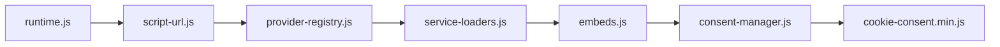

# MODX 2 frontend refactor — 1.0.4-beta4

Дата: 16 октября 2026 года. Только MODX 2. Ветка `codex/modx2-frontend-refactor`, исходная проверенная beta3 — `ab78ef1365c95514d57b4b63922539e6ac5ea395`. До начала tracked tree чистое; единственный untracked файл `docs/modx2-frontend-inventory.md` сохранён без изменений и не включён в коммиты. `main`, исходная ветка beta3 и MODX 3 не изменялись. Push, merge, release и production deployment не выполнялись.

## Архитектура и зависимости

Раньше четыре источника составляли bundle: runtime, script URL policy, registry вместе с SDK/очередями/URL карт и consent manager вместе с iframe lifecycle. Теперь сборка явно конкатенирует шесть источников в прежнюю защитную IIFE:



| Модуль | Ответственность |
| --- | --- |
| `runtime.js` | Прежние PHP-rendered сообщения и подстановка параметров; исходник не изменён. |
| `script-url.js` | Прежние `valid()`/`identity()` для custom JS; исходник не изменён. Builder поставляет его же отдельной копией Manager. |
| `provider-registry.js` | Каталог loaders/hosts/defaults, проверка schema/key/config, нормализация и заморозка enabled instances, duplicate/conflict checks, legacy fingerprint v2; прежний публичный facade. |
| `service-loaders.js` | Механически перенесённые `script`, `start`, Google Consent Mode/commands, Meta/VK queues, dedup и stopping; прежние URL, init и network-error semantics. |
| `embeds.js` | Механически перенесённые map URL allowlists, поиск wrappers/templates, inert placeholders, iframe attributes, revoke, modal и focus interaction. |
| `consent-manager.js` | Единственный consent owner: storage/migration/TTL/versions/visibility, Strict/Legacy, UI/buttons, committed choice, audit/ACK, callbacks, runtime gate и bounded reload. |

`web86ServiceLoaders` и `web86Embeds` — **внутренние lexical constants внутри bundle**, без новых window API или HTTP assets. SDK module получает frozen instances/categories из проверенного registry; `apply(value, mode, runtimeAllowed, legacyAutoLoad)` получает committed value, mode и живой guard от consent owner. Внешний `web86Providers` делегирует прежние `allowed`, `apply`, `revoke` в SDK module, `safeMapUrl` — в embeds. Делегирование ленивое: при определении facade ещё не вызываются последующие модули.

`web86Embeds.create({root, registry, services, mode, categoryVisibility, runtimeAllowed, openSettings})` вызывается менеджером после проверки DOM. Его private controller предоставляет `setup()`, `apply(value)`, `revoke(categories)` и `afterCommit(categories)`. `openSettings(load, category)` передаёт управление баннером и category input обратно consent manager. Map controller хранит только DOM references и pending dialog; consent state в нём нет.

Порядок запуска: определения runtime/URL/registry → SDK state → определение embeds factory → consent owner → единственный существующий DOMContentLoaded handler (или immediate initialize для уже готового документа) → storage restore/identity → embeds setup → registry apply → embeds apply → banner/callbacks. При отзыве: committed choice/audit → `reloading = true` → registry revoke → embeds revoke → ACK либо 900 мс → reload. При обычном commit: apply → callbacks → восстановление pending map dialog, как в beta3.

`runtimeAllowed(category)` в `consent-manager.js` остаётся единственным источником effective permission: не идёт reload, категория видима, есть committed grant или подтверждённый первый Legacy-визит. Persisted `categories_v2` отдельно. Legacy до выбора оставляет `getConsent() === null`, не пишет основную consent-запись и accept audit, не добавляет Google consent commands/flags и не меняет независимые defaults сайта. Старый отказ/partial/expiry/policy/stale/corrupt/archive/storage failure не расширяется. SDK stopping — прежняя остановка lifecycle, а не второй consent engine. Draft inputs, DOM CustomEvent и изменения storage в текущем документе разрешения не выдают.

Публичная совместимость: frozen `window.web86Providers` с прежними свойствами и порядком `services`, `categories`, `validate`, `validScriptPath`, `allowed`, `safeMapUrl`, `revoke`, `apply`; `window.web86CookieConsent.getConsent/openSettings/onAllowed`; callback получает `stillAllowed`, регистрация возвращает `unsubscribe`. `resetForTesting` остаётся только в mock. Нового `onConsentChange` нет.

## Как расширять

Новый SDK: сначала PHP/public registry contract и конфигурация/catalog в `provider-registry.js`, затем adapter в `service-loaders.js::start()`. Использовать существующие `script()` и instance token dedup; не добавлять storage reading или отдельную логику согласий. Проверять guard перед новым действием после await; не менять общую retry-политику скрытно. Добавлять проверки Strict/Legacy, всех назначаемых категорий, disabled, duplicate, revoke и SDK параметров.

Будущие videos/template mounting относятся к `embeds.js` и отдельной задаче с собственными PHP/HTML contracts, URL policies, inert markup и lifecycle tests. В beta4 остаются только прежние Google/Яндекс.Карты. YouTube, RUTUBE, VK Видео, generic template API и `mountEmbeds()` **не реализованы**; Issue #12 не изменён.

## Сборка и артефакт

`_build/frontend.mjs` использует прежний pinned esbuild 0.28.2, явную конкатенацию, target es2020 и guard повторной инициализации. Runtime imports/chunks не добавлены. Minification — только build phase. PHP Assets snippet и content-hash cache busting не изменены. Native builder поставляет единственный bundle по прежнему пути; новые исходники отдельно не устанавливаются.

- Signature: `cookieconsent-1.0.4-beta4`, самостоятельный native `modPackageBuilder` transport.
- ZIP: `.local/artifacts/cookieconsent-1.0.4-beta4.transport.zip`.
- SHA256: `c81482abe94502b7e95d898f3bffa2a40b279595e1ec60669ed02bbd70869a4a`.
- Bundle: 22 745 bytes, SHA256 `e4b90c9982ad27d3c1dac9bf2c8fcf30b0a07aa970fb09be23c4b5e96c97ffb2`.
- Beta3 bundle: 21 944 bytes, SHA256 `c641196439d5b187461df049018245ec2ad73f9b2723073955b434a2a5ccf796`.
- Beta3 ZIP сохранён: SHA256 `0e55b968695fc1ad9c04becca1037218c385e836dad5a63d489a61f523cae95d`.
- Native inventory: 57 runtime files, 73 vehicles (14 object / 57 file / 2 script), 140 ZIP entries.
- Две независимые native build directories после штатной ZIP normalization дают одинаковые bytes. Source inventory paths не изменились; Manager получает ту же URL policy; все 10 mock files сохранены по фактическим путям.
- Frontend manifest: 9 inputs, 2 outputs; проверяются input/output SHA256, bytes, повторная сборка, guide/version outputs и соответствие ZIP bundle. Legacy files, mock, fingerprints, categories_v2, schema 3, PHP settings/default texts/native objects сохранены. Из runtime PHP изменены только generated version и техническая ссылка в generated guide; Manager UI logic не менялась.

## Проверки и сравнение beta3

Baseline сохранён **до** переноса: [машиночитаемый контракт](../tests/frontend-refactor/baseline.json), source/native hashes, публичные методы, SDK URL и hashes существующих consent fixtures. Свежий baseline на настоящем MODX: Legacy browser 24 / 176 assertions и category matrix 30 / 330, оба PASS.

Прямое сравнение immutable `git show ab78ef1:...` и candidate использует одинаковые DOM/storage fixtures в отдельных Chromium contexts. Сравнивает exact persisted consent, schema 3 audit payload/order, frozen service/fingerprint/API, script insertion order и число, SDK URL/parameters/queues, Google commands/site defaults, map HTML/attributes, focus/dialog и fixture cookies. Время/UUID детерминированы; stack frames минифицированных функций исключены, тексты ошибок сравниваются. Проверены Strict/Legacy, live/mock, все категории, duplicate bundle, allow/refuse/partial/expiry/policy/stale/corrupt/archive/storage failure/hidden, network failure, async Meta revoke, no-banner page и CSP без unsafe-inline/eval.

Полное differential comparison: **PASS, 44 сценария / 186 assertions**, без расхождений. Focused-проверка после переноса maps: PASS, 14 / 56. Build/inventory checks: PASS, 53 assertions. Synthetic cookies в differential suite подтверждают выполнение fixture scripts; реальные cookie/runtime SDK проверяются отдельно direct-vendors suite и не приравниваются к доставке в кабинет.

**Итог: 0 неустранённых FAIL.** Все результаты ниже получены заново в этом задании.

| Проверка | Результат | Объём |
| --- | --- | --- |
| Beta3 → candidate differential | PASS | 44 сценария / 186 assertions |
| Focused SDK extraction и focused map extraction | PASS | По 14 / 56 для каждого этапа |
| Legacy browser: Strict/Legacy, Google defaults, storage, async revoke, audit ACK | PASS | 24 / 176 |
| Каждый адаптер в каждой из трёх назначенных категорий | PASS | 30 / 330 |
| Existing universal regression runner | PASS | Все 20 suites, без повторов |
| Beta2-compatible Accept/URL/Manager checks | PASS | 11 / 130 |
| Реальные публичные SDK: direct/current, cookies, init, Google commands и reject/reload | PASS | 10 / 177; telemetry отвечается локально |
| Public registry native upgrade | PASS | 6 / 59 |
| Документированные integration/i18n examples | PASS | 5 / 22 |
| Native Manager system settings | PASS | 4 / 13 |
| Fenom browser: RU/EN, split/legacy, cold/warm, migration и invalid JSON | PASS после fixture retry | 31 / 768 |
| Fenom Strict/Legacy × RU/EN × parser/syntax/cache | PASS после fixture retry | 24 / 480 |
| Native beta1/beta2/beta3 → beta4, exact consent/settings/log data | PASS | 3 перехода / 96 |
| Native lifecycle **точного окончательного ZIP**: fresh, upgrade, reinstall, uninstall | PASS | 7 / 220, MODX 2.8.8 |
| Beta3 → **точный окончательный ZIP**, exact persisted choice и content hash | PASS | 1 / 32 |
| Окончательный native payload + Manager source help / Preview isolation | PASS | 1 / 65; PHP 8.2.34, все 57 runtime hashes |
| Окончательный native reinstall + runtime/Reject/ACK/reload под PHP 8.1 | PASS | 1 / 68; PHP 8.1.34, все 57 runtime hashes |
| PHP categories/audit/visibility/URL contracts | PASS | По 3 268 assertions под PHP 8.1.34 и 8.2.34 |
| PHP/Fenom regressions и syntax | PASS | 12 PHP suites; lint 106 PHP и syntax 121 JS/MJS; последний изменённый test helper дополнительно node --check |
| Manifest/version/guide/native inventory/reproducibility | PASS | 53 assertions; 9 inputs / 2 outputs; два одинаковых final ZIP |
| Native ZIP verifier | PASS | 140 entries, 73 vehicles: 14 object + 57 file + 2 script |
| События в реальных кабинетах / опубликованные теги GTM | SKIP | Не предоставлены принадлежащие владельцу тестовые ID/container |
| Production/client hosting, Firefox/WebKit/Safari/mobile, блокировщики и юридическая приёмка | SKIP | Ручные release gates |

Первичный полный прогон сохранил два FAIL: отдельный Fenom fixture содержал bundle beta3 (`c641…`), что обнаружила проверка content hash. Его assets обновлены штатным `tests/local/sync.php`, обе affected suites повторены успешно. Runner теперь выполняет явную подготовку этого fixture перед Fenom-проверками. Первичная финальная Manager-проверка также сохранила FAIL из-за штатного Gravatar-запроса самого MODX: тест уточнён до component SDK/Preview traffic, при этом Gravatar по-прежнему перехватывается и наружу не уходит. Повторная проверка прошла; исходные FAIL logs/results не переписаны.

При подготовке differential harness исправлены неверный root-relative fixture path с query, повторное seeding storage на reload, ожидание завершения scripts и сравнение minifier stack frames. Финальные сравнения обязательно проверяют, что registry принят и SDK fixtures действительно исполняются. Первая native build попыталась писать в read-only source bind; окончательные независимые build выполнены в writable `/tmp` контейнера.

Полный universal/legacy/SDK/PHP прогон использовал **тот же окончательный frontend bundle и consent PHP**. После него точный final ZIP, дополнительно содержащий исправленные технические ссылки Manager, независимо прошёл native lifecycle, beta3 upgrade, все runtime hashes, Manager и PHP 8.1 install. Реальные vendor cookies проверены direct-vendors suite; synthetic differential cookies не выдаются за обработку в кабинете.

Результаты полной native/browser/PHP приёмки и ограничения фиксируются в [сводке evidence](evidence/modx2-frontend-refactor.json). Полные текущие логи: `.local/frontend-refactor/`, отдельные suite evidence в существующих `.local/*-evidence/`. Исторические acceptance reports не переписаны.

## Повторная и ручная проверка

Подготовить штатные disposable MODX 2 fixtures и immutable beta1/beta2/beta3 ZIP/inventory. Не использовать клиентскую БД или production URL. Сборка: `node _build/transport.mjs /var/www/html /tmp/<новая-папка>` в штатном локальном Compose; перенести ZIP/inventory из контейнера, выполнить `_build/normalize.py`, `_build/verify.php`. Для reproducibility использовать две новые папки.

```sh
npm run build:frontend
node tests/frontend-refactor/equivalence.mjs
node tests/frontend-refactor/build.mjs
# Сбрасывает ТОЛЬКО именованные disposable clean/publiccore fixtures:
node tests/frontend-refactor/acceptance.mjs --native
```

1. На staging сделать backup, сверить SHA ZIP, установить beta4 через Package Manager. Проверить active version и фактический content-hashed bundle. Очистить штатные MODX/Fenom/HTML/CDN cache, при необходимости OPcache.
2. Strict (`buttons.accept=false`), новый профиль: до выбора нет SDK/custom JS/iframe. Выбрать каждую категорию отдельно: стартуют только enabled members её назначения. Reject запрещает загрузку. Повторить карты Google/Яндекс и локальный/HTTPS custom JS.
3. Legacy (`buttons.accept=true`), подтверждённый первый визит: enabled/visible SDK и maps стартуют до клика, `getConsent()` null, основной storage key отсутствует, accept audit отсутствует. В Google queues нет CMP consent default/update или собственного поля `cookie_consent` в gtm.js; обычные GA4/Ads параметры и независимые defaults сайта сохранены.
4. Accept/Save: один committed audit с ACK/event_id и одна JSONL запись; `categories_v2` сохранён; повторных SDK/iframe нет. `onAllowed` выполняется один раз, `unsubscribe` и `stillAllowed` работают после await.
5. Reopen → уменьшить разрешение или Reject: guards false сразу, запрещённые iframe удалены, ACK либо максимум 900 мс до reload; после reload запрещённые сервисы не стартуют. Повторить при pending SDK/network failure.
6. Returning visitors: точные сохранённые consent bytes при native beta3→beta4 upgrade; отказ/partial, TTL/policy/category versions, corrupt storage и legacy archive не превращаются в auto-load grants. Внутренний рефакторинг сам не увеличивает category versions.
7. Map в native dialog: кнопка открывает cookie settings, фокус на назначенной категории; Save разрешённой категории возвращает dialog. Escape и обычный opener возвращают фокус как раньше.
8. Проверить RU/EN, split/legacy snippets, cold/warm Fenom, Manager Preview isolation и CSP; Network/Console без неожиданных sources, дублей или нарушений.
9. На отдельной staging fixture выполнить fresh/upgrade/reinstall/uninstall, проверить сохранность settings/texts/IDs/metadata/logs и отсутствие удаления пользовательских файлов. Uninstall не означает удаление пользовательских данных.

## Ограничения и release gates

Реальные SDK replay в локальном Chromium не подтверждают получение данных аккаунтами поставщиков. Нужны принадлежащие владельцу тестовые IDs, проверка опубликованных GTM tags, фактических событий и выбранного Consent Mode. Это отдельный gate; отсутствие cookies не доказывает отсутствие запросов.

Production/client hosting, клиентские шаблоны/интеграции, Safari/Firefox/mobile, блокировщики, CDN/OPcache и юридическое одобрение Legacy режима остаются ручными release gates. Отзыв не отменяет уже отправленные запросы/выполненный произвольный JS и не удаляет универсально сторонние cookies. Нужна staging-приёмка точного ZIP, backup/restore и отдельное разрешение на публикацию/выкладку.

Изменённые файлы перечислены в [списке](modx2-frontend-refactor-files.txt). Последовательность тематических коммитов и итоговый SHA — в финальном ответе; собственный SHA не встраивается в коммитируемый отчёт.
